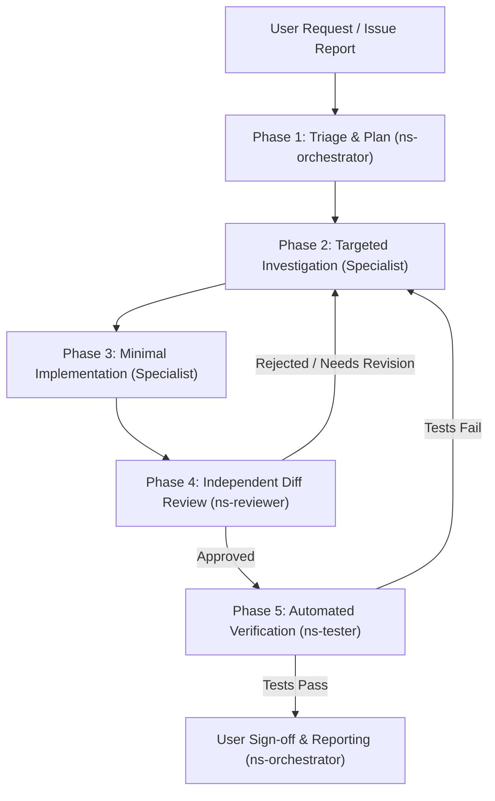

# NS Cloud Drive - Multi-Agent Engineering Architecture Framework

## Executive Summary
This architecture provides a scalable, resource-efficient, and fail-safe multi-agent development environment for NS Cloud Drive. Built on Antigravity's native subagent orchestration, the framework establishes clear separation of concerns, strict quality gates, bounded execution, and token cost controls.

---

## Architectural Principles

### 1. Hierarchical Delegation & Single Authority
All task intake, prioritization, and task routing are governed by the **Lead Orchestrator (`ns-orchestrator`)**. Specialists operate strictly within their assigned boundaries. No specialist may bypass the Orchestrator or perform unassigned cross-module modifications.

### 2. Independent Skeptical Verification
Every code proposal and diff must pass an independent audit by the **Independent Reviewer (`ns-reviewer`)**. The Reviewer has read-only access and operates with zero bias toward the implementing specialist. The Reviewer actively searches for strict-mode violations, regression risks, and unverified assumptions.

### 3. Empirical Evidence Rule
No agent may report a task or milestone as "complete", "working", or "passing" without presenting verbatim terminal output showing exit code 0 and explicit test pass assertions from **QA & Testing (`ns-tester`)**.

### 4. Zero Regressions & Backwards Compatibility
Existing configuration schemas (`settings.json`), encrypted credentials (DPAPI), active virtual drive letters (`G:`, `H:`, `I:`, `N:`, `T:`), and cache structures must be preserved. Any breaking architectural changes must be reviewed and approved by the user.

### 5. Strict Permission Gate for Git Mutations
Agents are strictly prohibited from executing `git commit`, `git push`, or destructive operations (`git reset --hard`, `Remove-Item` on user data) without explicit, real-time confirmation from the user.

---

## Component Architecture Mapping

```
+----------------------------------------------------------------------------------------------------+
|                                           NS CLOUD DRIVE                                           |
+----------------------------------------------------------------------------------------------------+
|                                                                                                    |
|  [Presentation & UX]                                      [Core Virtual Drive (VFS)]               |
|  * src/NSCloudDrive.ps1                                   * src/services/VirtualDriveManager.ps1   |
|  * src/ui/ProviderConnectionWindow.ps1                    * src/services/ExplorerIntegration.ps1   |
|  * src/ui/EmbeddedBrowserWindow.ps1                       * WinFsp FUSE-NTFS Driver                |
|  * src/ui/AccountManagerWindow.ps1                        * Rclone Mount Engine                    |
|  Assigned: ns-ui                                          Assigned: ns-backend                     |
|                                                                                                    |
|  [Cloud Integrations & Auth]                              [Storage, Cache & Telemetry]             |
|  * src/providers/GoogleDriveProvider.ps1                  * src/services/CacheManager.ps1          |
|  * src/providers/TeraBoxProvider.ps1                      * src/services/CloudTransferManager.ps1  |
|  * src/services/TeraBoxBridgeManager.ps1                  * D:\CloudCache\<accId>\vfs (SSD Cache)  |
|  * OAuth 2.0 PKCE & WebDAV Bridge                         * LRU Eviction & File Lock Probing       |
|  Assigned: ns-cloud                                       Assigned: ns-cache-transfer              |
|                                                                                                    |
|  [Performance & Diagnostics]                              [Security & Secret Protection]           |
|  * src/services/SystemDiagnosticService.ps1               * src/services/SettingsManager.ps1       |
|  * EmptyWorkingSet Memory Trimming                        * Windows DPAPI Cryptography             |
|  * Dispatcher Timer Throttling                            * Log Redaction & Token Isolation        |
|  * CLR ThreadPool Offloading (Add-Type)                   * Reparse Point & Path Traversal Guards  |
|  Assigned: ns-performance                                 Assigned: ns-security                    |
|                                                                                                    |
|  [Verification & Quality Gate]                                                                     |
|  * tests/* (32+ Automated Test Suites)                                                             |
|  * tests/Run-AllTests.ps1                                                                          |
|  * Diff Audit & Regression Defense                                                                 |
|  Assigned: ns-tester & ns-reviewer                                                                 |
+----------------------------------------------------------------------------------------------------+
```

---

## Sustainable Maintenance Cycle

The maintenance lifecycle runs on a predictable, token-efficient 5-phase loop:



1. **Phase 1: Triage & Plan**: Orchestrator analyzes requirements, maps the component, verifies baseline test status, and sets bounds.
2. **Phase 2: Investigation**: Assigned specialist reads exact line ranges without broad repository scans.
3. **Phase 3: Implementation**: Specialist performs minimal, surgical edits preserving strict mode and encoding rules.
4. **Phase 4: Independent Review**: Reviewer audits the diff against the 10-point checklist and strict mode.
5. **Phase 5: Verification**: Tester runs automated suites and captures terminal evidence.
