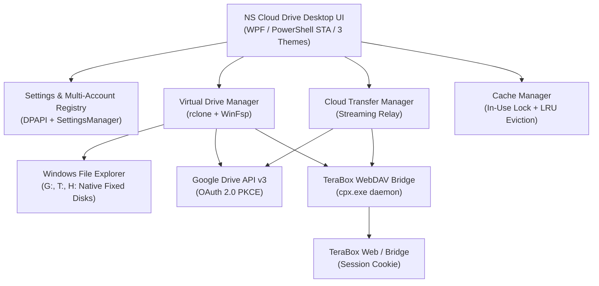

# NS Cloud Drive

**NS Cloud Drive** is an experimental PowerShell/WPF Windows preview for Google Drive and TeraBox virtual-drive workflows. It is not production-ready or release-certified: real provider accounts, multi-account mounts, transfer recovery, packaging, and resource usage have not all been validated on an isolated Windows test machine.


> **Status:** The repository contains application code and mocked/structural regression tests. Passing those tests does not prove a successful live cloud mount or safe operation on real user data. Review [Security and limitations](docs/SECURITY-AND-LIMITATIONS.md) before using it with important accounts or files.

## Core Capabilities

- **Virtual-drive integration code**: The app builds rclone/WinFsp mount workflows. Actual drive visibility, file operations, and mount reliability still require isolated Windows integration testing.
- **Desktop UI**: Navigation includes `Disks`, `Options`, `Analytics`, `Logs`, and `Help`; account cards use provider-verified identity data when available.
- **Theme options**:
  - **Pure Black** (`#000000`): High-contrast OLED dark theme.
  - **Translucent Liquid Glass**: Uses a Windows DWM backdrop where available. Whole-window transparency has not been visually verified across supported Windows configurations.
  - **Pure White** (`#F8FAFC`): Clean, crisp light theme with refined contrast.
- **On-demand Analytics and Logs**: Sampling and provider quota checks are designed to run only while Analytics is open; Logs use bounded reads and run off the UI dispatcher. These behaviors have structural/sandboxed tests, not long-running UI performance certification.
- **Transfers**: The code includes rclone-based transfer workflows, progress reporting, and pause/resume controls. Live provider transfers, interruption recovery, and data-integrity guarantees are not verified.
- **Cache helpers**: Cache configuration, in-use checks, and startup recovery exist. Startup recovery is restricted to recognized account/provider namespaces; cache eviction and pending-write safety still need isolated integration testing.
- **Account isolation**: Synthetic tests cover separate IDs, token files, and settings. Two real Google accounts and concurrent TeraBox sessions have not been tested.
- **Resource usage**: The app has no verified idle RAM/CPU baseline or performance target. See the read-only [resource snapshot script](tests/Benchmark-ResourceUsage.ps1).

## Engineering Knowledge Base

For implementation details and verified debugging history, start with the
[engineering architecture](docs/engineering/ARCHITECTURE.md). The knowledge
base also includes the [Google Drive multi-account lifecycle](docs/engineering/GOOGLE_DRIVE_MULTI_ACCOUNT.md),
[incident and fix evidence](docs/engineering/INCIDENTS_AND_FIXES.md),
[TeraBox troubleshooting](docs/engineering/TERABOX_TROUBLESHOOTING.md), and
[testing and validation limits](docs/engineering/TESTING_AND_VALIDATION.md).
The reusable coding-agent workflow is
[`ns-clouddrive-debugging`](.github/skills/ns-clouddrive-debugging/SKILL.md);
it requires future agents to read the relevant documentation and regression
tests before revisiting a known issue.

Compact source map:

- `src/NSCloudDrive.ps1`: WPF app, startup, status, UI, Analytics, Logs.
- `src/providers/`: Google Drive and TeraBox authentication/provider adapters.
- `src/services/`: settings, rclone/WinFsp mounts, bridge, cache, background
  operations, Explorer integration, and transfers.
- `src/ui/ProviderConnectionWindow.ps1`: account creation and settings flow.
- `tests/`: PowerShell unit, mocked, structural, isolated WPF, and
  provider/mount-oriented tests; read a test before running it.

Run a focused synthetic account regression from the repository root:

```powershell
powershell.exe -NoProfile -ExecutionPolicy Bypass -File .\tests\Test-AccountCreationSaveFlow.ps1
powershell.exe -NoProfile -ExecutionPolicy Bypass -File .\tests\Test-GoogleAccountCreationRecovery.ps1
powershell.exe -NoProfile -ExecutionPolicy Bypass -File .\tests\Test-StartupAutoMountTimer.ps1
```

These tests do not prove live concurrent Google mounts or concurrent TeraBox
support. Review [testing and validation](docs/engineering/TESTING_AND_VALIDATION.md)
before running provider- or mount-oriented suites.

---

## Architecture & Technology Stack

The diagram shows intended script boundaries, not verified live integration behavior.



---

## Quick Start & Installation

### Prerequisites
1. **Windows 10 / 11** (64-bit).
2. **WinFsp**: Windows File System Proxy (required for virtual drive mounting).
3. **Microsoft Edge WebView2 Runtime** (installed by default on Windows 10/11).
4. **rclone** (v1.65+): Located automatically in `%LOCALAPPDATA%\NSCloudDrive\tools\rclone\` or on system `PATH`.
5. **cpx.exe**: TeraBox bridge daemon located in `%LOCALAPPDATA%\NSCloudDrive\tools\cpx\`.

### Launching NS Cloud Drive

#### Option 1: Quick Launch (CMD or Double-Click)
Double-click `NSCloudDrive.cmd` in the repository root, or run:
```cmd
.\NSCloudDrive.cmd
```

#### Option 2: PowerShell Terminal
```powershell
powershell.exe -NoProfile -ExecutionPolicy Bypass -STA -File .\src\NSCloudDrive.ps1
```

---

## Cloud Account Setup Guide

### Google Drive
1. Click **Add Cloud Disk** -> select **Google Drive**.
2. Complete the OAuth 2.0 loopback flow in your system browser using a configured Google OAuth client.
3. NS Cloud Drive verifies the returned identity and stores DPAPI-protected credentials.
4. Mounting depends on compatible rclone/WinFsp binaries and has not been certified against a live account in this repository's test environment.

### TeraBox
TeraBox uses an unofficial community backend and website-session authentication. This workflow is not release-certified and has not been validated against a live account. The official Open Platform API requires provider-issued credentials and is restricted to its app folder. Do not copy browser cookies or use this preview with important TeraBox data.

---

## Automated Test Suites

The repository includes PowerShell regression tests. Many are mocked, sandboxed, or structural; they do not establish live-provider or real-mount correctness. Run focused tests first. Do not run mount/write suites against active user drives.

For example, run a focused isolated test:

```powershell
powershell.exe -ExecutionPolicy Bypass -File .\tests\Test-SettingsManager.ps1
```

| Focused test | Scope |
| :--- | :--- |
| `Test-SettingsManager.ps1` | Sandboxed settings CRUD, malformed-settings preservation, and atomic writes. |
| `Test-CacheManagement.ps1` | Temporary-directory cache behavior and account-namespace recovery boundaries. |
| `Test-GoogleDriveProvider.ps1` | Synthetic OAuth/PKCE, DPAPI token isolation, and credential ACL checks; no real Google account. |
| `Test-TeraBoxProvider.ps1` | Synthetic DPAPI sessions and mocked offline validation; no live TeraBox account. |
| `Test-LogsPage.ps1`, `Test-AnalyticsPage.ps1` | Sandboxed log checks and structural UI assertions. |
| `Test-MultiAccountLifecycle.ps1`, `Test-StartupAutoMountTimer.ps1` | Mocked lifecycle and timer regressions; no mount processes started. |

The full runner includes additional Windows/mount-oriented tests. It was not run in this task because active provider/mount processes were present and some suites may affect them.

---

## Continuous Integration (CI)

A GitHub Actions workflow is configured in `.github/workflows/ci.yml` running on `windows-latest`:
- **PowerShell AST Syntax Validation**: Scans all repository `.ps1` and `.psm1` files for syntax or parser errors.
- **Secret Scanning**: Verifies that no unredacted credentials, tokens, or private keys are committed.
- **Automated Test Execution**: Runs the repository test runner on an isolated CI worker; this does not certify real provider behavior.

---

## Security & Privacy Notes

- Google and TeraBox credentials use DPAPI-backed `PSCredential` storage. ACL updates use Windows .NET access-control APIs, are applied before credentials are saved, and fail explicitly if protection cannot be applied. Tests use synthetic credentials in temporary directories.
- OAuth PKCE and callback-state checks have local regression tests; no real authorization flow was performed in this validation.
- The shared log store redacts common token/cookie formats and is bounded, but sanitization does not guarantee removal of every provider-specific secret.
- Startup cache recovery only scans recognized account/provider cache folders. No remote-file deletion was performed. Cache eviction and pending-write behavior still need isolated integration testing.
- A scoped source review reported no findings in the changes it reviewed. No external rclone/CPX binary audit, penetration test, real-provider test, or production security certification was performed.

See [docs/SECURITY-AND-LIMITATIONS.md](docs/SECURITY-AND-LIMITATIONS.md) for verification scope and operational limits.

---

## Performance & Resource Utilization

No comparable NS Cloud Drive UI RAM, private-byte, CPU, handle, thread, or startup baseline was available during the latest validation because the UI process was not running. A read-only snapshot observed active `rclone` and `cpx` processes only; those figures are provider/mount-process usage, not application idle usage or before/after optimization evidence. The benchmark script does not launch or terminate processes and does not scan cache files.
