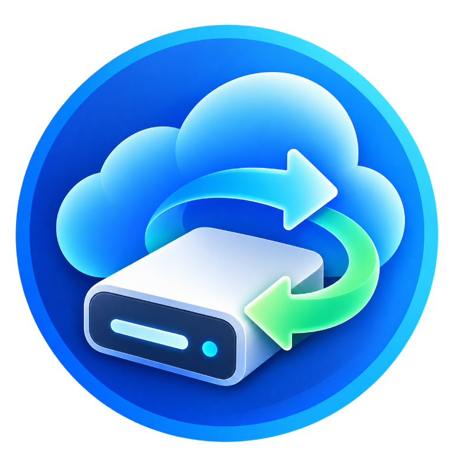
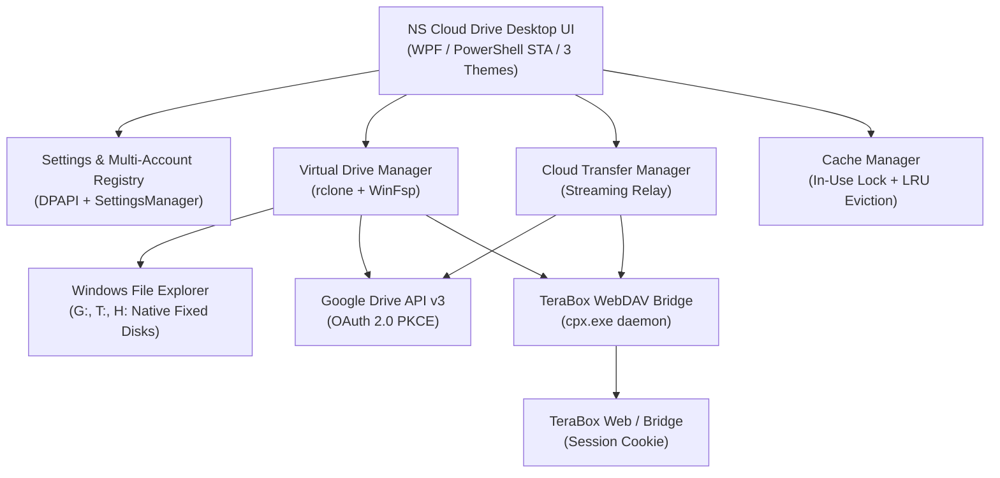

# NS Cloud Drive

**NS Cloud Drive** is a lightweight, high-performance Windows desktop application that mounts cloud storage accounts (Google Drive and TeraBox) directly into Windows File Explorer as native virtual drives, providing seamless browsing, streaming playback, uploads, cloud-to-cloud transfers, and minimal local resource usage.



## Core Capabilities

- **Native Windows File Explorer Integration**: Cloud drives mount as local fixed disks (`FixedDisk`), eliminating network redirector "red X" artifacts, UNC drive issues, or `FUSE-rclone` labels. Open, copy, paste, rename, and stream files directly in File Explorer.
- **Air Live Drive-Inspired Desktop UI**: Clean, modern interface featuring a navigation sidebar (`Disks`, `Options`, `Help`), provider badge icons, direct `Connect` / `Disconnect` buttons, drive letter combo (`in [ G: v ]`), quick action buttons (📁 Explorer, ⚙ Settings, ⬆ Upload, ✕ Remove), live storage capacity progress bars, and an embedded `Options` view.
- **Three Supported Themes**:
  - **Pure Black** (`#000000`): High-contrast OLED dark theme.
  - **Translucent** (`#13161CE6`): Modern dark acrylic glass style.
  - **Pure White** (`#F8FAFC`): Clean, crisp light theme with refined contrast.
- **Cloud-to-Cloud Streaming Transfers**:
  - Dedicated transfer dialog (`+ Transfer Files`) with dual cloud directory browsers.
  - Streaming relay mode (`rclone copy` / `rclone move`) pipes data directly between cloud remotes in bounded memory chunks (4–8 MiB) without buffering full files on the local operating system drive.
  - Supports transfers between Google Drive and TeraBox in both directions, and between multiple accounts of the same provider.
  - Live throughput and ETA monitoring with Exponential Moving Average ($\alpha = 0.25$) speed smoothing.
  - Pause and resume transfers via Win32 thread suspension (`NtSuspendProcess` / `NtResumeProcess`).
- **Cache Management & OS Drive Protection**:
  - In-use file lock protection (`Test-FileInUse`) guarantees active streaming files, open handles, and pending uploads are never evicted.
  - Configurable cache location (default: `D:\CloudCache`) with OS drive safety warnings if configured on `%SystemDrive%`.
  - LRU size bounding (configurable quota: 10 GB, 20 GB, 50 GB, 100 GB, 200 GB) based on file access times.
  - Automatic startup recovery of orphaned temporary chunks (`.partial`, `.rclone-tmp`, `*~`).
- **Multi-Account Isolation**:
  - Support for multiple concurrent accounts (e.g., Personal Google Drive `G:`, Work Google Drive `H:`, TeraBox `T:`).
  - Dynamically allocated remote aliases (`gdrive_<id>`, `terabox_<id>`) and isolated DPAPI credential files.
- **Low Memory & Background Efficiency**:
  - Throttled UI refresh timers, minimal polling, and Win32 `EmptyWorkingSet` memory trimming reducing working set RAM to ~10 MB when minimized to the System Tray.

---

## Architecture & Technology Stack



---

## Quick Start & Installation

### Prerequisites
1. **Windows 10 / 11** (64-bit).
2. **WinFsp**: Windows File System Proxy (required for virtual drive mounting).
3. **Microsoft Edge WebView2 Runtime** (installed by default on Windows 10/11).
4. **rclone** (v1.65+): Located automatically in `%LOCALAPPDATA%\NSCloudDrive\tools\rclone\` or on system `PATH`.
5. **cpx.exe**: TeraBox bridge daemon located in `%LOCALAPPDATA%\NSCloudDrive\tools\cpx\`.

### Launching NS Cloud Drive

#### Option 1: Quick Launch (CMD or Double-Click)
Double-click `NSCloudDrive.cmd` in the repository root, or run:
```cmd
.\NSCloudDrive.cmd
```

#### Option 2: PowerShell Terminal
```powershell
powershell.exe -NoProfile -ExecutionPolicy Bypass -STA -File .\src\NSCloudDrive.ps1
```

---

## Cloud Account Setup Guide

### Google Drive
1. Click **Add Cloud Disk** -> select **Google Drive**.
2. Click **Sign in with Google** to complete standard OAuth 2.0 desktop authorization in your browser.
3. The authorization handler validates root Drive metadata, retrieves storage quota, and stores DPAPI-encrypted tokens.
4. The account mounts automatically as `G:` (or your preferred drive letter) in read-write mode.

### TeraBox
1. Click **Add Cloud Disk** -> select **TeraBox**.
2. The embedded Edge WebView2 sign-in dialog opens.
3. Complete sign-in on the official TeraBox website. NS Cloud Drive captures the session securely and encrypts it with DPAPI.
4. The local CPX WebDAV bridge daemon starts automatically on loopback (`127.0.0.1:19191`).
5. The account mounts as `T:` (or your preferred drive letter) in read-write mode.

---

## Automated Test Suites

NS Cloud Drive includes 15 automated test suites covering unit logic, security, multi-account isolation, caching, transfers, and regression:

```powershell
powershell.exe -ExecutionPolicy Bypass -File .\tests\Run-AllTests.ps1
```

| Suite | Focus Area |
| :--- | :--- |
| `Test-ConnectionState.ps1` | State machine transitions, fail-closed handling, secret sanitization. |
| `Test-TeraBoxProvider.ps1` | DPAPI session storage, regional API endpoints, strict mode parsing. |
| `Test-TeraBoxBridgeManager.ps1` | WebDAV bridge daemon, DPAPI entropy key generation, remote environments. |
| `Test-GoogleDriveProvider.ps1` | OAuth 2.0 PKCE S256 test vectors, token isolation, and dynamic remotes. |
| `Test-VirtualDriveManager.ps1` | WinFsp detection, mount arguments, fixed disk mode, drive conflict fallback. |
| `Test-SettingsManager.ps1` | Multi-account registry CRUD, settings serialization, startup tasks. |
| `Test-DesktopUIRegression.ps1` | STA window construction, modal interfaces, layout width constraints. |
| `Test-EmbeddedBrowserWindow.ps1` | WebView2 runtime detection, host verification, non-blocking dispatcher pumps. |
| `Test-MultiAccountIsolation.ps1` | Concurrent multi-account isolation, remote naming, and truthful drive states. |
| `Test-ThemesAndAccountCustomization.ps1`| 3-theme resolution, dynamic STA theme switching, diagnostic safety. |
| `Test-CloudTransferManager.ps1` | Streaming relay transfer, speed smoothing, ETA math, path traversal defense, argument escaping. |
| `Test-CacheManagement.ps1` | In-use file lock protection, LRU quota eviction, OS drive detection, startup recovery. |
| `Test-EndToEndAcceptance.ps1` | Multi-account isolation, WebDAV environment, memory trimming (< 10 MB). |
| `Test-WriteAndUploadVerification.ps1` | Read-write mount arguments, upload verification, live account integrity. |
| `Test-RcloneConfigPassword.ps1` | DPAPI credential protection and private ACL enforcement. |

---

## Continuous Integration (CI)

A GitHub Actions workflow is configured in `.github/workflows/ci.yml` running on `windows-latest`:
- **PowerShell AST Syntax Validation**: Scans all repository `.ps1` and `.psm1` files for syntax or parser errors.
- **Secret Scanning**: Verifies that no unredacted credentials, tokens, or private keys are committed.
- **Automated Test Execution**: Executes the test suite runner across all unit and regression suites.

---

## Security & Privacy Model

- **No Plaintext Secrets at Rest**: All OAuth tokens, refresh tokens, and cookies are encrypted with Windows DPAPI scoped to the current interactive user.
- **Private NTFS ACLs**: Credential directories and files restrict access strictly to the current user SID and SYSTEM, with directory inheritance (`ContainerInherit | ObjectInherit`).
- **Command Argument Escaping**: Child processes are launched using Win32-compliant argument escaping (`Format-SafeProcessArgument`) preventing CLI injection.
- **Path Traversal Defense**: Cloud relative paths are normalized (`Normalize-CloudPath`) to strip control characters and resolve `..` and `.` segments safely.
- **Multi-Pattern Diagnostic Sanitization**: All error messages and logs pass through `Format-SanitizedDiagnosticMessage` redacting tokens, cookies, auth headers, and keys.
- **No Cloud File Deletion**: Automated tests and cache eviction operations never delete cloud files.

See [docs/SECURITY-AND-LIMITATIONS.md](docs/SECURITY-AND-LIMITATIONS.md) for the complete Threat Model and operational limits.

---

## Performance & Resource Utilization

Empirical measurements on Windows 11:
- **Cold Application Startup**: ~1.5 seconds.
- **Idle Memory Footprint**: ~10–15 MB working set when minimized (trimmed via Win32 `EmptyWorkingSet`).
- **Idle CPU Usage**: < 0.2%.
- **VFS Disk Cache**: Bounded to configured limit (default: 20 GB) on dedicated non-OS storage.
