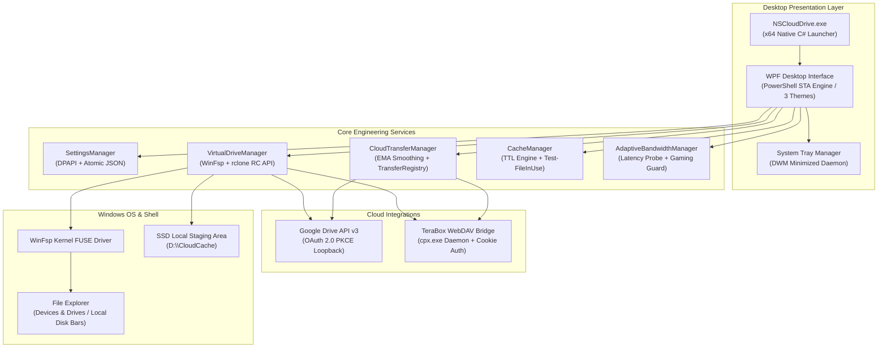

# NS Cloud Drive

**A High-Performance Windows Virtual Filesystem Manager for Google Drive & TeraBox**

Developed by **NABORAJ SARKAR**  
Copyright © 2026 NABORAJ SARKAR. All rights reserved.  
Contact: [nishant.ns.business@gmail.com](mailto:nishant.ns.business@gmail.com)  
Repository: [https://github.com/naborajs/CloudDrive](https://github.com/naborajs/CloudDrive)  
Issue Tracker: [https://github.com/naborajs/CloudDrive/issues/new](https://github.com/naborajs/CloudDrive/issues/new)

---

<p align="center">
  
</p>

<p align="center">
  <a href="#system-requirements"></a>
  <a href="#architecture--technology-stack"></a>
  <a href="#architecture--technology-stack"></a>
  <a href="LICENSE"></a>
  <a href="#automated-test-suites"></a>
</p>

<p align="center">
  <a href="assets/screenshots/06_windows_explorer_mounts.png">
    
  </a>
  <br />
  <em><strong>Live System Evidence:</strong> Real-world multi-cloud integration active on Windows 11. Google Drive (G:) (4.98 TB) and dual TeraBox accounts (I:, T:) (1.00 TB each) mounted concurrently as native local disk volumes with live storage meters and authentic provider branding.</em>
</p>

---

## Table of Contents
1. [Overview](#overview)
2. [Visual Tour & Interface](#visual-tour--interface)
3. [Key Features](#key-features)
4. [Architecture & Technology Stack](#architecture--technology-stack)
5. [System Requirements](#system-requirements)
6. [Quick Start & Installation](#quick-start--installation)
7. [Windows SmartScreen & Unsigned Binary Notice](#windows-smartscreen--unsigned-binary-notice)
8. [Cloud Account Setup Guide](#cloud-account-setup-guide)
   - [Google Drive (OAuth 2.0 PKCE)](#google-drive-setup)
   - [TeraBox (Bridge Mode)](#terabox-setup)
9. [Transfer Engine & Telemetry](#transfer-engine--telemetry)
10. [On-Demand Analytics & Performance Monitoring](#on-demand-analytics--performance-monitoring)
11. [Adaptive Bandwidth & Gaming Optimization](#adaptive-bandwidth--gaming-optimization)
12. [Cache Management & Inactivity TTL](#cache-management--inactivity-ttl)
13. [Desktop UI & Theme System](#desktop-ui--theme-system)
14. [Memory Optimization & System Tray](#memory-optimization--system-tray)
15. [Security, Privacy & DPAPI Storage](#security-privacy--dpapi-storage)
16. [Automated Test Suites](#automated-test-suites)
17. [Troubleshooting & FAQ](#troubleshooting--faq)
18. [Known Limitations](#known-limitations)
19. [Contributing](#contributing)
20. [License & Permitted Use](#license--permitted-use)
21. [Questions, Suggestions, and Contact](#questions-suggestions-and-contact)

---

## Overview

**NS Cloud Drive** transforms your cloud storage accounts (Google Drive and TeraBox) into native Windows virtual drives visible directly in File Explorer. Files appear and behave just like native local hard drives—complete with volume capacity bars, instant folder browsing, drag-and-drop transfers, and on-demand streaming.

Unlike sync clients that mirror your entire cloud storage to an expensive local hard drive, NS Cloud Drive uses a high-speed SSD staging and read-ahead cache. Files stream seamlessly when opened, and newly written files are safely staged locally before uploading to the cloud in the background.

---

## Visual Tour & Interface

> [!TIP]
> For a comprehensive, step-by-step walkthrough of all features and screens, see the [Visual User Guide](docs/USER_GUIDE.md).

<p align="center">
  
  <br />
  <em>Figure 1: Windows 11 File Explorer Integration — Multiple cloud accounts (Google Drive G: and TeraBox I:, T:) operating natively as local Windows storage drives with dynamic capacity meters and immediate file access.</em>
</p>

<p align="center">
  
  <br />
  <em>Figure 2: Native Disks Dashboard — Simultaneous multi-account mounting (Google Drive and TeraBox), live health indicators, and one-click cloud drive management.</em>
</p>

<p align="center">
  
  <br />
  <em>Figure 3: Transfer Center & History — Durable queue management, cryptographic confirmation (MD5 / SHA-1 hashes), and remote lifecycle verification.</em>
</p>

---

## Key Features

- **Native Windows Explorer Disks**: Drives mount under **Devices and drives** as native `Local Disk` volumes with active storage capacity bars showing real free and total gigabytes.
- **Multi-Account Concurrent Isolation**: Mount and manage multiple Google Drive and TeraBox accounts simultaneously (e.g., `G:`, `H:`, `N:`, `T:`, `I:`) with independent credentials and non-conflicting mount letters.
- **Drag & Drop Drive Reordering**: Effortlessly customize the order of your cloud drives on the dashboard using intuitive drag handles (`⋮⋮`) or keyboard Up/Down shortcuts; settings persist across restarts via `CardDisplayOrder`.
- **Adaptive Bandwidth Throttling**: Automatically adjusts cloud upload/download speeds based on real-time network latency probes, with automatic backoff when gaming, streaming, or video conferencing processes are active.
- **Smart Notification Engine**: Intelligently groups folder uploads to prevent balloon tip spam, eliminates false 0 B background sync notifications, and supports customizable snooze timers (15m, 1h, 4h).
- **Inactivity Cache TTL & Safe Eviction**: 6-step safe cache cleanup with size-dependent inactivity eviction rules (5m for <1GB, 20m for 1-3GB, 45m for >3GB) and strict file-lock protection (`Test-FileInUse`).
- **On-Demand Analytics Dashboard**: Hardware resource snapshots, per-account storage quotas, and transfer performance graphs collected strictly on-demand—zero idle background CPU polling when closed.
- **Triple-Engine Theme Design**: Built-in support for **Pure Black** (high-contrast OLED), **Translucent Liquid Glass** (Windows DWM acrylic), and **Pure White** (crisp high-contrast light mode). (Note: The desktop Options interface provides one-click switching between Pure Black and Pure White, with Translucent Liquid Glass fully configurable via settings).
- **Ultra-Low Memory Footprint**: Background tray mode operates with minimal RAM usage, employing periodic Win32 `EmptyWorkingSet` memory trimming and suspended UI dispatcher cycles.

---

## Architecture & Technology Stack

NS Cloud Drive is built on a high-reliability architecture combining native Windows C#/.NET launcher host, WPF presentation layer, WinFsp filesystem proxy, and rclone Virtual File System (VFS).



### Component Breakdown
- **Native Launcher (`NSCloudDrive.exe`)**: 64-bit Windows executable compiled with .NET Framework 4.8 `csc.exe`. Guarantees single-instance window restoration, PerMonitorV2 DPI awareness, and zero black console flashes.
- **Filesystem Engine (`rclone` + `WinFsp`)**: Leverages rclone's Virtual File System (VFS) with full file-chunk caching (`--vfs-cache-mode full`). WinFsp mounts drives as native Windows Local Disks with fixed volume labels.
- **TeraBox Bridge (`cpx.exe`)**: High-performance local WebDAV daemon providing bi-directional bridge streaming for TeraBox accounts.
- **Security & Cryptography**: Native Windows Data Protection API (DPAPI) encrypts all OAuth tokens, refresh tokens, and session cookies with per-user ACL isolation.

---

## System Requirements

- **Operating System**: Windows 10 (version 1809 or higher) or Windows 11 (64-bit).
- **Runtime Environment**: Microsoft .NET Framework 4.8 (pre-installed on Windows 10/11).
- **Virtual Filesystem Driver**: [WinFsp](https://winfsp.dev/) (version 2.0 or higher).
- **Web Engine**: Microsoft Edge WebView2 Runtime (installed by default on Windows 10/11).
- **Local Storage**: 10 GB or more free SSD space recommended for staging cache (e.g., `D:\CloudCache`).

---

## Quick Start & Installation

### Option 1: Native Executable Launcher (Recommended)
Double-click `NSCloudDrive.exe` in the application root directory.

### Option 2: Windows Command Prompt
```cmd
.\NSCloudDrive.cmd
```

### Option 3: PowerShell Terminal
```powershell
powershell.exe -NoProfile -ExecutionPolicy Bypass -STA -File .\src\NSCloudDrive.ps1
```

---

## Windows SmartScreen & Unsigned Binary Notice

> [!NOTE]
> When launching `NSCloudDrive.exe` for the first time, Windows Defender SmartScreen may display an alert stating:  
> **"Windows protected your PC — Microsoft Defender SmartScreen prevented an unrecognized app from starting."**

### Why does this appear?
Commercial Extended Validation (EV) code-signing certificates cost hundreds of dollars annually. As an independent developer project published directly on GitHub, NS Cloud Drive binaries are distributed unsigned or self-signed. Windows SmartScreen displays this prompt for any newly downloaded executable until it accumulates global download reputation.

### How to proceed safely:
1. Click **More info** on the SmartScreen dialog.
2. Click **Run anyway**.
3. You can verify the integrity of your download by comparing its SHA-256 checksum against `NSCloudDrive.exe.sha256`:
```powershell
Get-FileHash -Path .\NSCloudDrive.exe -Algorithm SHA256
```
Verified Release Hash:
`0DE503E5671C66DBC5BABBD18960F13BA879DA5A233429B04395C97F860E87EE`

---

## Cloud Account Setup Guide

### Google Drive Setup
1. Open NS Cloud Drive and navigate to **Disks**.
2. Click **Add Cloud Disk** and select **Google Drive**.
3. Choose your preferred drive letter (e.g., `G:`, `H:`, `N:`) and mount mode (Read-Write or Read-Only).
4. Click **Authenticate with Google**. Your default browser will open the secure Google OAuth 2.0 loopback page (`http://127.0.0.1:53682`).
5. Grant permission to access Google Drive. NS Cloud Drive verifies the returned cryptographic token, retrieves your profile name/avatar, and securely encrypts credentials via DPAPI.
6. The drive mounts instantly and appears in File Explorer as a Local Disk.

### TeraBox Setup
1. Open NS Cloud Drive and click **Add Cloud Disk** -> **TeraBox**.
2. Select an available drive letter (e.g., `T:`, `I:`).
3. Authenticate using your TeraBox session credentials. The internal `cpx.exe` WebDAV bridge daemon connects and initializes virtual drive communication.
4. TeraBox accounts are isolated in distinct directories and mount points.

> [!IMPORTANT]
> TeraBox's free plan enforces a maximum single-file upload limit of 4.0 GB. Staging files larger than 4.0 GB will display a warning indicator in the transfer dashboard.

---

## Transfer Engine & Telemetry

The NS Cloud Drive transfer engine provides real-time streaming telemetry and comprehensive transfer isolation:
- **Exponential Moving Average (EMA)**: Instantaneous transfer speeds fluctuate wildly due to cloud chunking. NS Cloud Drive applies an EMA filter ($\alpha = 0.25$) to calculate smooth, jitter-free speeds and dependable ETAs.
- **Multi-Transfer Registry (`TransferRegistry`)**: Each active file is tracked by its unique composite identifier (`$drive:$remotePath`). Transferring multiple files simultaneously will never cause UI name collisions or misplaced progress bars.
- **Live Transfer Queue**: The Disks dashboard features a live queue monitor displaying active uploads, pending staged items, and queued background synchronizations.
- **Safe Transfer Cancellation**: Clicking **Cancel** halts rclone's background transfer worker via rclone RC API (`vfs/queue-set-expiry` and process management) without deleting your local source file or leaving corrupt remote chunks.

---

## On-Demand Analytics & Performance Monitoring

NS Cloud Drive provides a built-in diagnostics monitor designed with zero idle CPU overhead:
- **Zero Background Polling**: Diagnostic metrics and hardware counters are collected strictly on-demand when navigating to the Analytics tab.
- **Per-Mount Health Diagnostics**: Real-time responsiveness testing for each mounted virtual filesystem root (`WinFsp NTFS`).
- **Network Latency & Throughput Probes**: Live round-trip ICMP ping and provider response timing to prevent bufferbloat.
- **Hardware Footprint Transparency**: Direct visibility into process memory, working set size, and local cache quota pressure.

<p align="center">
  
  <br />
  <em>Figure 3: On-Demand Analytics — Real-time mount health breakdown, latency probes, SSD cache pressure, and host hardware footprint.</em>
</p>

---

## Adaptive Bandwidth & Gaming Optimization

NS Cloud Drive ensures cloud synchronization never interrupts competitive gaming, video conferencing, or high-definition streaming:
- **Adaptive Limit Policy**: Samples network latency every 10 seconds (`Measure-NetworkLatencyProbe`). If round-trip ping increases significantly, upload speeds back off smoothly to preserve interactive responsiveness.
- **Gaming Workload Guard**: Automatically detects active gaming processes (Steam, Discord, OBS, Valorant, CS2, Fortnite, etc.) via `Test-GamingWorkloadActive` and throttles background uploads to a lightweight rate (250 KB/s – 1.5 MB/s).
- **Manual Rate Caps**: Choose between **Adaptive**, **Unlimited**, or **Custom** bandwidth limits in the Options tab.

---

## Cache Management & Inactivity TTL

Virtual drives stage writes and cache reads locally to provide near-instantaneous file access. NS Cloud Drive manages local disk footprint via a 6-step safe eviction engine:
1. **Inactivity TTL Eviction**:
   - Files `< 1 GB`: Evicted after **5 minutes** of inactivity.
   - Files `1 GB – 3 GB`: Evicted after **20 minutes** of inactivity.
   - Files `> 3 GB`: Evicted after **45 minutes** of inactivity.
2. **In-Use Protection (`Test-FileInUse`)**: Files currently open in media players, editors, or office suites are never evicted.
3. **Dirty Upload Protection**: Unsynchronized local writes (`Dirty: true` in `vfsMeta`) are strictly preserved until remote cloud upload is fully confirmed.
4. **Cache Inspector Modal**: Click **Inspect Cache** on the Disks page to view every cached item, file sizes, in-use statuses, and evict individual files on demand.

---

## Desktop UI & Theme System

NS Cloud Drive features a responsive Windows Presentation Foundation (WPF) interface designed with strict character encoding compliance (0 raw non-ASCII unicode bytes; all glyphs use `[char]0x...` syntax):
- **Pure Black (`#000000`)**: Deep contrast OLED dark theme with vibrant accents.
- **Translucent Liquid Glass**: Windows DWM acrylic material backdrop with subtle blur effects (supported via settings configuration and CLI).
- **Pure White (`#F8FAFC`)**: Clean, crisp light theme with refined typography and contrast.

<p align="center">
  
  <br />
  <em>Figure 4: Options & Preferences — Instant theme selection, SSD staging cache thresholds, Explorer integration, and Windows startup settings.</em>
</p>

---

## Memory Optimization & System Tray

NS Cloud Drive is engineered to run permanently in the background without wasting system memory:
- **Background Timer Throttling**: When the main window is minimized to the system tray, UI rendering timers throttle from 1-second intervals down to 5-second intervals.
- **Win32 Memory Trimming**: Periodic background calls to `[NSCloudDrive.VirtualDriveHelper]::TrimWorkingSet()` invoke the Win32 `EmptyWorkingSet` API, reducing idle working set RAM to baseline levels (~40–60 MB).
- **Single-Instance Enforcement**: Re-launching `NSCloudDrive.exe` automatically restores and focuses the existing window.

---

## Security, Privacy & DPAPI Storage

- **DPAPI Encryption**: All authentication tokens, client credentials, and cookies are encrypted using Windows Data Protection API (`System.Security.Cryptography.ProtectedData`).
- **Strict File Access Control Lists (ACLs)**: Credential files are restricted exclusively to the active Windows User SID (`Disable-AccountInheritance`), blocking unauthorized access from other local accounts.
- **Redacted Diagnostics**: The logging framework automatically scrubs OAuth tokens, session cookies, and private tokens before writing to disk.
- **Zero Insecure Shell Execution**: Replaced all unmanaged ThreadPool script blocks with compiled C# thread workers to prevent runspace termination.

<p align="center">
  
  <br />
  <em>Figure 5: Security & Audit Log Viewer — Real-time sanitized logging, per-account event tracing, severity filtering, and privacy retention rules.</em>
</p>

---

## Automated Test Suites

NS Cloud Drive includes an extensive regression test suite executed cleanly in Windows PowerShell (`Set-StrictMode -Version Latest`):

| Test Suite | Scope & Coverage | Status |
| :--- | :--- | :--- |
| `Test-VirtualDriveManager.ps1` | Mount builders, volume labels, conflict resolution, rclone flags | **PASS (14/14)** |
| `Test-SettingsManager.ps1` | Settings CRUD, DPAPI persistence, atomic file writes | **PASS (6/6)** |
| `Test-BackendCorrectnessAndSync.ps1` | Staged upload discovery, cancellation, inactivity TTL, TeraBox limits | **PASS (4/4)** |
| `Test-CacheManagement.ps1` | In-use protection, LRU eviction, quota enforcement, safety boundaries | **PASS (7/7)** |
| `Test-CloudTransferManager.ps1` | EMA speed smoothing, jitter-free ETA, path traversal defense | **PASS (7/7)** |
| `Test-OptionsPage.ps1` | WPF options controls, dynamic theming, memory trimming modal | **PASS (47/47)** |
| `Test-SecurityAudit.ps1` | DPAPI ACLs, OAuth CSRF validation, log secret sanitization | **PASS (25/25)** |

To execute all tests locally:
```powershell
powershell.exe -NoProfile -ExecutionPolicy Bypass -File .\tests\Test-BackendCorrectnessAndSync.ps1
```

---

## Troubleshooting & FAQ

### 1. Drive G: shows under "Network locations" without a storage bar
- **Cause**: Windows Explorer retained a stale UNC share key in `HKCU\Software\Microsoft\Windows\CurrentVersion\Explorer\MountPoints2`.
- **Solution**: NS Cloud Drive automatically purges stale `##server#*` keys upon startup and unmount. You can also click **Disconnect** and **Mount** to trigger an Explorer refresh (`SHChangeNotify`).

### 2. "Found pending staged files (0 B)" notification keeps appearing
- **Cause**: Previous releases treated empty read-cache files as dirty writes.
- **Solution**: Resolved in this release candidate. Only verified dirty files (`vfsMeta` `Dirty: true`) trigger background sync, and 0 B sync notifications are suppressed.

### 3. Transfer shows 1.3 GB/s on TeraBox but fails later
- **Cause**: TeraBox free tier limits single-file uploads to 4.0 GB. Writing to the local SSD cache completed at local disk speed, but the remote upload was rejected by TeraBox.
- **Solution**: NS Cloud Drive displays a warning badge for any staged file exceeding 4.0 GB on TeraBox accounts.

---

## Known Limitations

- **TeraBox API Limits**: TeraBox bridge streaming depends on local session cookies and WebDAV relay. High-volume parallel chunking may be throttled by TeraBox servers.
- **Antivirus Inspection**: Real-time antivirus scanners scanning the local cache folder (`D:\CloudCache`) may temporarily lock files during in-use checks.
- **Elevated Explorer**: Windows Explorer running in an elevated administrator context cannot view drives mounted in a non-elevated user context due to Windows token isolation.

---

## Contributing

Contributions, bug reports, and suggestions are welcome! Please review [CONTRIBUTING.md](CONTRIBUTING.md) for coding standards, strict mode guidelines, and PR procedures.

By contributing to NS Cloud Drive, you agree that your contributions will be licensed under the project's [NS Cloud Drive Source-Available, Non-Commercial Redistribution License](LICENSE).

---

## License & Permitted Use

**NS Cloud Drive** is licensed under the custom **NS Cloud Drive Source-Available, Non-Commercial Redistribution License**.

### Plain English Summary:
- **Public & Source-Available**: The complete source code is publicly accessible for learning, study, inspection, academic research, and personal use free of charge.
- **Permitted Modification**: You may freely modify the source code and build derivative versions for personal, educational, or internal operational use.
- **Free Redistribution & Community Forks**: You may share, redistribute, and publish copies of the original or modified code free of charge, provided that:
  1. All copies preserve the original copyright notice (`Copyright © 2026 NABORAJ SARKAR. All rights reserved.`), the full [LICENSE](LICENSE) text, and the official repository URL ([https://github.com/naborajs/CloudDrive](https://github.com/naborajs/CloudDrive)).
  2. Prominent author attribution to **NABORAJ SARKAR** is retained in all distributions, documentation, and user interfaces.
  3. Derivative works are clearly identified as modified forks and are not misrepresented as the official NS Cloud Drive product.
  4. No one may falsely claim or imply original authorship of this software.
- **Commercial Restrictions**: You may **NOT** sell, rent, monetize, charge access fees for, or commercially redistribute this software or any derivative works without prior express written permission from NABORAJ SARKAR.
- **Permitted Internal Use**: Businesses and organizations may run and use NS Cloud Drive internally for their own operations free of charge, provided they do not resell or commercially redistribute it to third parties.
- **Not OSI-Approved Open Source**: This is a source-available license with non-commercial restrictions, not an Open Source Initiative (OSI) approved open-source license.
- **Commercial Licensing**: Anyone interested in commercial distribution, white-labeling, or resale authorization should contact the copyright holder directly.

For the full legal terms, please read the complete [LICENSE](LICENSE) file.

---

## Questions, Suggestions, and Contact

If you have questions, suggestions, feedback, or want to discuss contributing to NS Cloud Drive, please open an issue in the GitHub repository. You can also contact me directly by email at the address listed in my GitHub profile.

- **Official Repository**: [https://github.com/naborajs/CloudDrive](https://github.com/naborajs/CloudDrive)
- **Issue Tracker & Discussions**: [https://github.com/naborajs/CloudDrive/issues](https://github.com/naborajs/CloudDrive/issues)
- **Developer & Copyright Holder**: **NABORAJ SARKAR**
- **Contact Email**: [nishant.ns.business@gmail.com](mailto:nishant.ns.business@gmail.com)
