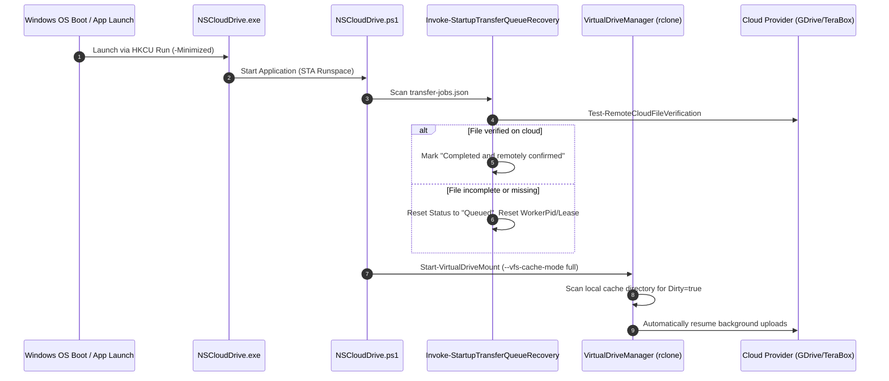

# NS Cloud Drive — Recovery, Staging Retention & Cache Architecture

**Author / Maintainer:** NABORAJ SARKAR  
**Technical Modules:** `src/services/CacheManager.ps1`, `src/services/VirtualDriveManager.ps1`, `src/services/CloudTransferManager.ps1`  

---

## 1. Storage & Cache Namespace Taxonomy

Caching in NS Cloud Drive is a fundamental reliability requirement, not merely a performance optimization. The cache directory (`D:\CloudCache` or `%LOCALAPPDATA%\NSCloudDrive\cache`) is partitioned into distinct functional layers:

```
D:\CloudCache\
  ├── <AccountId_A>\
  │     ├── vfs\             <- Staged upload sources and active read caches
  │     │     └── <remote>\
  │     └── vfsMeta\         <- Metadata tracking state, dirty flags, and timestamps
  │           └── <remote>\
  │                 └── file.dat (JSON: { "Dirty": true, "AccessTime": ... })
  └── <AccountId_B>\
        ├── vfs\
        └── vfsMeta\
```

### Data Categorization & Protection Rules

| Category | Description | Protection Policy |
| :--- | :--- | :--- |
| **1. Disposable Read / Preview Cache** | Clean cached files downloaded on demand for playback or viewing (`Dirty: false`, no open locks). | Eligible for inactivity TTL eviction once retention threshold is exceeded. |
| **2. Pending Write-Back Data** | Files copied to virtual drives waiting for remote transmission (`Dirty: true` in `vfsMeta`). | **STRICTLY IMMUNE TO EVICTION.** Zero deletion under any circumstances. |
| **3. Active Upload Sources** | Files actively being read and streamed by rclone or transfer workers (`Test-FileInUse` returns `$true`). | **STRICTLY IMMUNE TO EVICTION.** File locking prevents access. |
| **4. Recoverable Failed / Cancelled Staging** | Staged files whose uploads failed transiently or were paused by the user. | **RETAINED SAFELY.** Staging preserved so user does not lose copied data. |
| **5. Uploaded Data Awaiting Remote Confirmation** | 100% of bytes sent, but awaiting cloud commit/hash verification. | **RETAINED.** Staged file must exist until remote verification passes. |
| **6. Successfully Completed Data** | Files confirmed remotely. | Subject to post-transfer cleanup policy (`KeepCache`, `RemoveAfterVerifiedUpload`, or TTL). |

---

## 2. Inactivity Cache Eviction TTL Policy

`Invoke-InactivityCacheEviction` enforces the user-requested size-dependent inactivity policy:

- **Cache smaller than 1 GB**: **5-minute** inactivity TTL.
- **Cache from 1 GB through 3 GB inclusive**: **20-minute** inactivity TTL.
- **Cache larger than 3 GB**: **45-minute** inactivity TTL.

### Safety Guards Before File Eviction:
1. **Dirty Check**: Inspects `<path>.vfsMeta`. If `Dirty: true`, eviction is aborted.
2. **File Lock Check**: Calls `Test-FileInUse` (`[System.IO.File]::Open(..., FileMode.Open, FileAccess.ReadWrite, FileShare.None)`). If locked, eviction is aborted.
3. **Physical Drive Guard**: Verifies cache path does not touch system roots (`C:\`, `C:\Windows`, user Desktop/Documents).
4. **Namespace Isolation**: Deletions are bounded strictly to verified account subdirectories (`<AccountId>\vfs\*`).

---

## 3. Restart & Crash Recovery Protocol



### Recovery Verification Checklist:
- [x] Durable queue reconstruction from `transfer-jobs.json`.
- [x] Unverified interrupted jobs reset to `Queued` readiness.
- [x] Completed remote uploads detected before retrying.
- [x] Rclone VFS persistent write-back resumes from local SSD staging.
- [x] Zero loss of user files during unexpected reboot.
