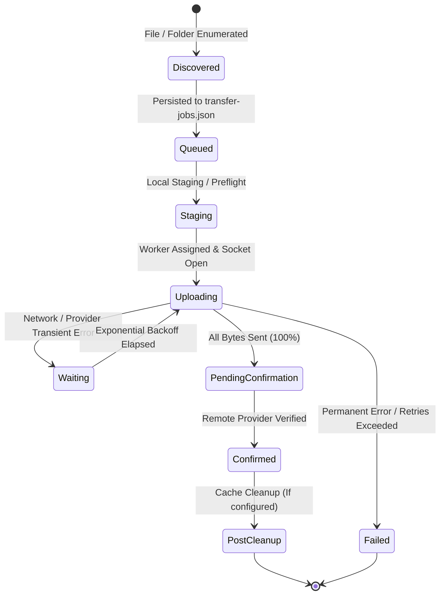

# NS Cloud Drive — Transfer Architecture & Queue Lifecycle

**Author / Maintainer:** NABORAJ SARKAR  
**Technical Module:** `src/services/CloudTransferManager.ps1` & `src/services/VirtualDriveManager.ps1`  

---

## 1. Dual Transfer Architecture Overview

NS Cloud Drive supports two unified transfer pipelines:
1. **Virtual Drive VFS Write-Back Pipeline**: Captures writes from Windows File Explorer and Win32 applications writing directly to mounted drive letters (`G:\`, `T:\`, etc.).
2. **Resilient Transfer Queue Engine**: Durable, multi-file and full-folder batch engine managed by `CloudTransferManager.ps1` for direct cloud uploads and cloud-to-cloud synchronization.



---

## 2. Job Lifecycle States & State Transitions

Every job tracked in `transfer-jobs.json` moves through well-defined, honest lifecycle states:

| Lifecycle State | Meaning & Verification Guard |
| :--- | :--- |
| `Discovered` | File discovered during streaming recursive folder walk (`[System.IO.Directory]::EnumerateFiles`). |
| `Queued` | Job record persisted to `transfer-jobs.json`. Ready for scheduling by `Process-CloudTransferQueue`. |
| `Staging` | File being staged locally or undergoing preflight validation (`Test-ProviderUploadPreflight`). |
| `Uploading` | Transfer worker process active; socket streaming bytes to cloud remote. Worker PID and lease tracked. |
| `Waiting for network/provider` | Transient failure encountered (e.g., HTTP 429, socket timeout). Backoff delay calculated ($2^{\text{RetryCount}}$ sec). |
| `Upload pending remote confirmation` | 100% of bytes sent. Waiting for remote cloud file verification (`Test-RemoteCloudFileVerification`). |
| `Completed and remotely confirmed` | Cloud provider confirmed receipt, matching file size and existence. Terminal success state. |
| `Failed` | Permanent error encountered or maximum retries exceeded (default: 3). Non-blocking. |
| `Cancelled` | User explicitly aborted the transfer via UI or batch cancellation (`Stop-CloudTransferQueueItem`). |

---

## 3. Durable Queue Persistence (`transfer-jobs.json`)

- **File Location:** `%LOCALAPPDATA%\NSCloudDrive\state\transfer-jobs.json`
- **Concurrency & Locking:** Single-scheduler coordination enforced via named Windows Mutex:
  - Global Mutex: `Global\NSCloudDrive_TransferScheduler_Mutex`
  - Local Fallback: `Local\NSCloudDrive_TransferScheduler_Mutex`
- **Atomic Serialization Protocol:**
  1. Serializes in-memory `$script:CloudTransferQueue` to formatted JSON with depth 10.
  2. Writes to temporary file: `$targetFile.<GUID>.tmp`.
  3. Replaces target file atomically via `[System.IO.File]::Replace($tmpFile, $targetFile, $null)`.
  4. Guarantees zero data loss or partial writes if the system experiences a sudden power loss or process kill.

### Job Schema Fields
```json
{
  "JobId": "job_a1b2c3d4",
  "QueueId": "queue_a1b2c3d4",
  "BatchId": "batch_98765432",
  "BatchName": "PhotosBackup",
  "AccountId": "gdrive_primary",
  "ProviderId": "gdrive",
  "SourcePath": "C:\\Users\\User\\Pictures\\photo1.jpg",
  "DestinationPath": "Backups/2026",
  "DestinationFilePath": "Backups/2026/photo1.jpg",
  "DestinationDirectory": "Backups/2026",
  "RelativePath": "photo1.jpg",
  "FileName": "photo1.jpg",
  "FileSizeBytes": 10485760,
  "BytesTransferred": 5242880,
  "Status": "Uploading",
  "RetryCount": 0,
  "MaxRetries": 3,
  "NextRetryUtc": null,
  "LastError": "",
  "EnqueuedUtc": "2026-10-26T12:00:00.0000000Z",
  "StartedUtc": "2026-10-26T12:00:01.0000000Z",
  "CompletedUtc": null,
  "LastProgressUtc": "2026-10-26T12:00:03.0000000Z",
  "WorkerPid": 14220,
  "WorkerLeaseUtc": "2026-10-26T12:00:03.0000000Z",
  "BandwidthLimit": "off",
  "ConflictAction": "Skip",
  "IsMove": false,
  "Percentage": 50.0,
  "SmoothedSpeed": 2541280.0,
  "EtaSeconds": 2
}
```

---

## 4. Worker Concurrency & Rate Limiting

### 4.1 Bounded Worker Concurrency
To eliminate resource starvation and prevent provider lockout:
- **TeraBox Remote:** Strictly capped at **2 concurrent workers**. TeraBox's WebDAV bridge and web endpoints reject more than 2 parallel streams with HTTP 429 / 503.
- **Google Drive Remote:** Capped at **4 concurrent workers** with **32 MB chunk sizes** (`--drive-chunk-size 32M`).
- **Global Application Limit:** Default maximum 4 concurrent jobs across all accounts.

### 4.2 Aggregate Global Bandwidth Limits
Bandwidth limits apply globally across all active transfers without multiplier effects:
- `Unlimited`: Default mode; transfers run at maximum available wire throughput without artificial caps.
- `Limited`: Strict ceiling set via presets (`256 KB/s`, `512 KB/s`, `1 MB/s`, `2 MB/s`, `5 MB/s`, `10 MB/s`, or Custom). Applied dynamically via rclone RC API `core/bwlimit`.
- `MinimalBackground`: Conservative preset (256 KB/s) for uninterrupted video streaming and gaming.

---

## 5. Worker Lifecycle, Leases, and Crash Recovery

### 5.1 Heartbeat & Lease Watchdog
- Every active worker updates `WorkerLeaseUtc` and `LastProgressUtc` upon receiving telemetry.
- If a worker process exits prematurely or `WorkerLeaseUtc` expires beyond 60 seconds:
  1. The scheduler reclaims the abandoned job.
  2. Resets `WorkerPid = 0`.
  3. Evaluates error permanence (`Test-IsPermanentTransferError`).
  4. If transient: increments `RetryCount` and schedules retry after exponential backoff.
  5. If retries exceeded: marks `Failed` and continues the queue.

### 5.2 Application Startup & Windows Reboot Recovery
When the application starts or Windows restarts:
1. `Invoke-StartupTransferQueueRecovery` is executed.
2. Loads all jobs from `transfer-jobs.json`.
3. Interrupted jobs in states `Uploading`, `Staging`, or `Upload pending remote confirmation` are inspected.
4. Invokes `Test-RemoteCloudFileVerification` against the destination provider.
5. If the file exists remotely with the expected size: marked `Completed and remotely confirmed`.
6. If the file is incomplete or missing: reset to `Queued` readiness (`NextRetryUtc = MinValue`, `WorkerPid = 0`).
7. `Process-CloudTransferQueue` resumes uploads seamlessly without requiring user intervention.
