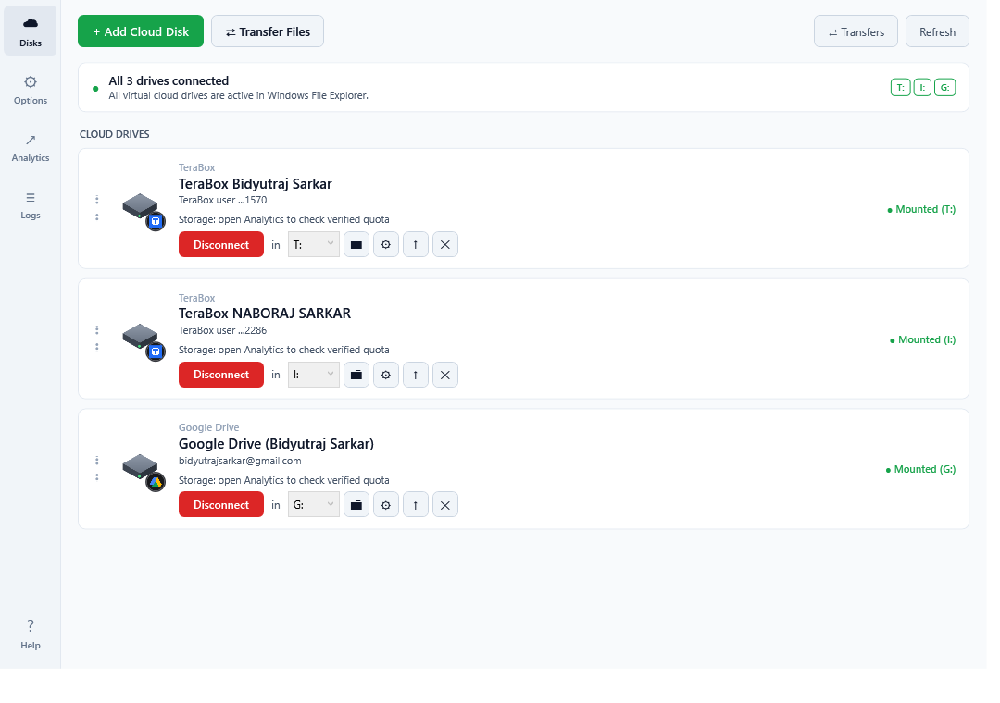
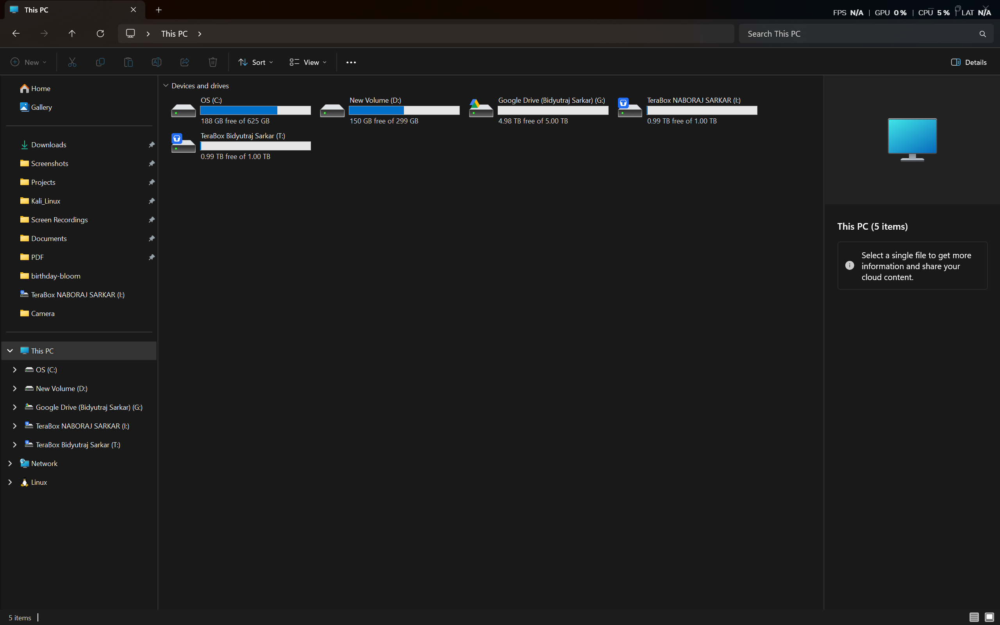
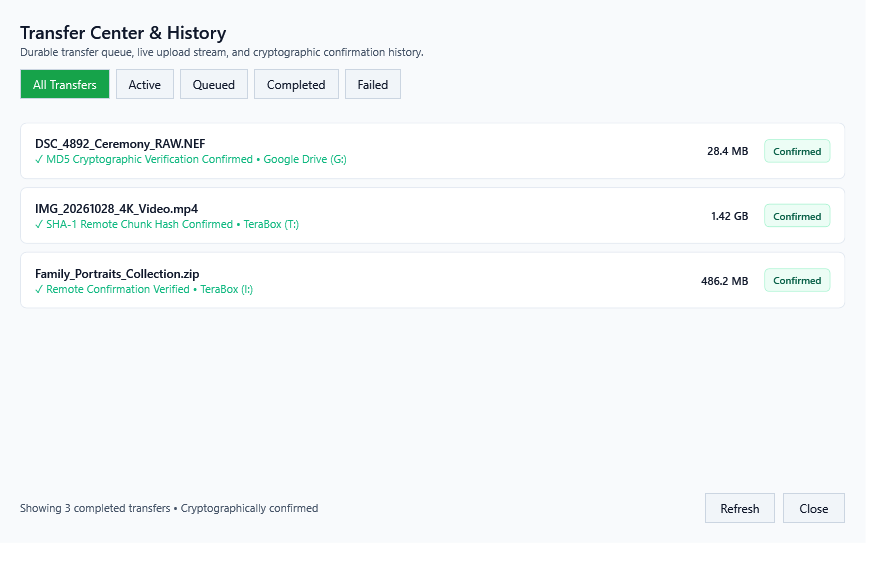
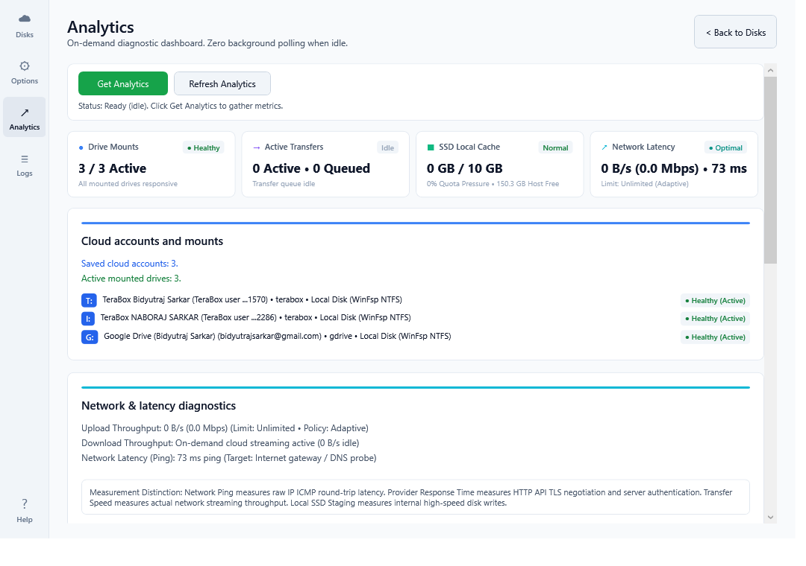
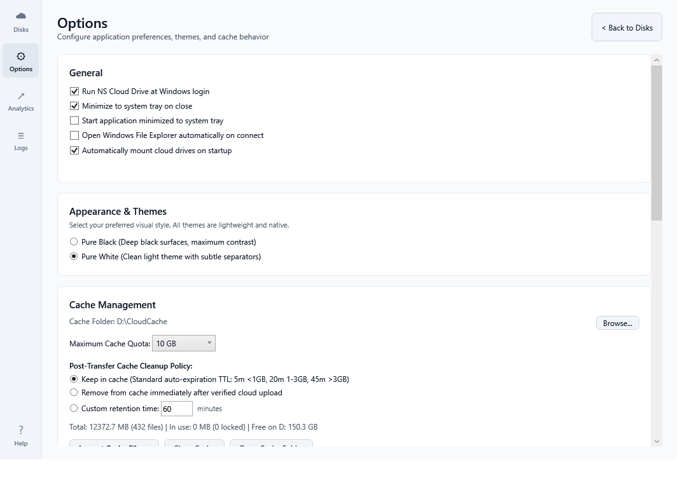
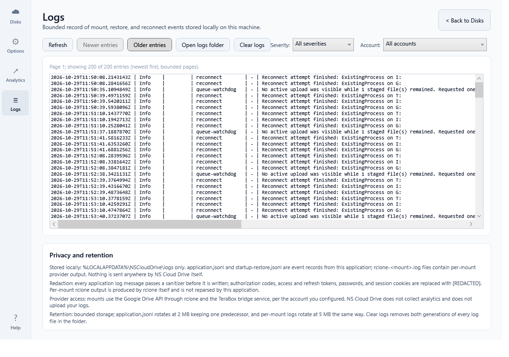

# NS Cloud Drive — Visual User Guide & Interface Walkthrough

Welcome to the **NS Cloud Drive User Guide**. This document provides an in-depth visual tour and operational walkthrough of all core features, screens, and workflows in the application.

---

## 1. Disks Dashboard (Main Screen)

The **Disks Dashboard** is the primary hub of NS Cloud Drive. It provides real-time visibility into all configured cloud accounts, active Windows mount points, and quick management actions.

  

### Key Interface Elements:
- **Header Status Banner**: Displays overall mount status across all accounts (e.g., `All 3 drives connected`). Shows interactive badges for each mounted drive letter (`T:`, `I:`, `G:`).
- **Toolbar Actions**:
  - `+ Add Cloud Disk`: Launches the provider connection dialog to connect a new Google Drive or TeraBox account.
  - `⇄ Transfer Files`: Opens the Cloud-to-Cloud Transfer dialog to transfer files directly between connected accounts.
  - `⇄ Transfers`: Opens the durable transfer queue and cryptographic history modal.
  - `Refresh`: Manually triggers a health and mount status probe across all virtual disks.
- **Drive Cards**:
  - **Account Details**: Shows provider type (Google Drive or TeraBox), user display name, and registered email or account ID.
  - **Mount Status Pill**: Green dot indicator (`● Mounted (G:)`) confirms active WinFsp filesystem integration.
  - **Mount / Disconnect Button**: Toggle button to mount or safely disconnect virtual drives on demand.
  - **Drive Letter Selector**: Select and assign preferred available Windows drive letters.
  - **Open Explorer Button**: Immediately opens Windows File Explorer at the virtual disk root.
  - **Account Settings & Reordering**: Configure account-specific options or drag cards to reorder.

---

## 2. Native Windows File Explorer Integration

Once mounted, all cloud disks appear directly inside Windows 11 File Explorer under **Devices and drives** just like physical storage volumes.

  

### Native Windows Features:
- **Direct Volume Letter Assignment**: Each account receives its own designated drive letter (e.g., `G:`, `I:`, `T:`).
- **Active Capacity Gauges**: Real-time storage consumption and remaining gigabytes/terabytes display natively in Windows Explorer.
- **Provider Branding**: Official high-resolution cloud icons (Google Drive, TeraBox) display in File Explorer for instant visual recognition.
- **Direct Shell Integration**: Drag-and-drop file copying, standard right-click context menus, and on-demand streaming on file open.

---

## 3. Cloud Transfer Center & History

The **Transfer Center** tracks all file transfers, local SSD staging progress, background uploads, and cryptographic confirmation results.

  

### Core Features:
- **Durable Queue Lifecycle**: Tracks files through staging, streaming, remote confirmation, and eviction.
- **Cryptographic Verification**: Confirms uploads against provider hashes (e.g., MD5 for Google Drive, SHA-1 chunk verification for TeraBox) before marking transfers as complete.
- **Category Filters**: Easily filter records by `All Transfers`, `Active`, `Queued`, `Completed`, and `Failed`.
- **Safe Recovery**: If a transfer is interrupted by a system restart, clear status indicators guide you to safely resume or re-upload files without risk of data corruption.

---

## 4. On-Demand Analytics & Performance Monitor

The **Analytics Dashboard** provides comprehensive hardware resource, network latency, and filesystem health metrics gathered strictly on demand—guaranteeing **zero background CPU polling** when idle.

  

### Telemetry Breakdown:
- **Drive Mounts**: Probes each active WinFsp NTFS mount root for real-time filesystem responsiveness (`Healthy (Active)` vs `Degraded`).
- **Active Transfers**: Real-time count of streaming and queued operations.
- **SSD Local Cache Quota**: Measures current cache utilization against configured maximum limits (e.g., `0 GB / 10 GB`) and available host drive storage.
- **Network Latency & Bandwidth Probes**: Measures live ICMP round-trip ping to public gateways and reports active streaming throughput.
- **Resource Footprint**: Displays current process RAM usage, working set size, and background worker state.

---

## 5. Options & Appearance Settings

The **Options** screen allows customization of visual themes, SSD staging folder locations, cache eviction rules, and Windows operating system integration.

  

### Configuration Options:
- **General Integration**:
  - `Run NS Cloud Drive at Windows login`: Registers automatic startup via Windows Run registry key.
  - `Minimize to system tray on close`: Keeps cloud drives mounted in the background when the main window is closed.
  - `Automatically mount cloud drives on startup`: Restores all configured virtual drives upon login.
- **Appearance & Themes**:
  - **Pure White**: High-contrast, clean modern light theme with refined borders and typography.
  - **Pure Black**: Deep OLED dark theme with vibrant color-coded status badges.
- **Cache Management**:
  - **Cache Folder**: Configurable dedicated high-speed SSD location (default: `D:\CloudCache`).
  - **Maximum Cache Quota**: Set cache limits from 5 GB up to 100 GB.
  - **Post-Transfer Cleanup Policy**: Automatically evict completed files using size-dependent inactivity TTLs (5m for <1GB, 20m for 1-3GB, 45m for >3GB) with strict `Test-FileInUse` lock protection.

---

## 6. Security & Audit Diagnostic Logs

The **Logs** view offers full transparency into application events, provider session validations, and mount operations while guaranteeing absolute privacy.

  

### Security & Privacy Protections:
- **Real-Time Sanitization**: All OAuth access tokens, refresh tokens, passwords, and session cookies are automatically replaced with `[REDACTED]` before logs are written to disk.
- **Severity & Account Filtering**: Filter events by `Info`, `Warning`, or `Error`, or isolate logs for a specific cloud account.
- **Local Bounded Storage**: Logs are stored strictly on your local machine in `%LOCALAPPDATA%\NSCloudDrive\logs` and automatically rotate at 2 MB to prevent unbounded disk usage.
- **Zero Remote Telemetry**: NS Cloud Drive never transmits log files, personal filenames, or diagnostic traces to external third-party servers.
