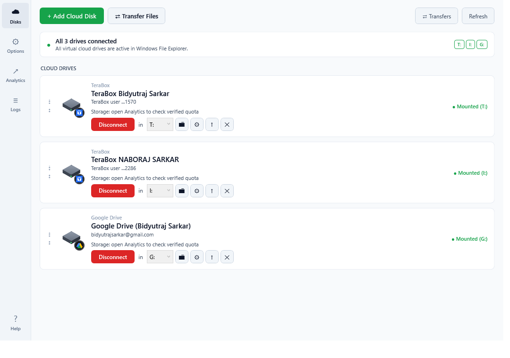
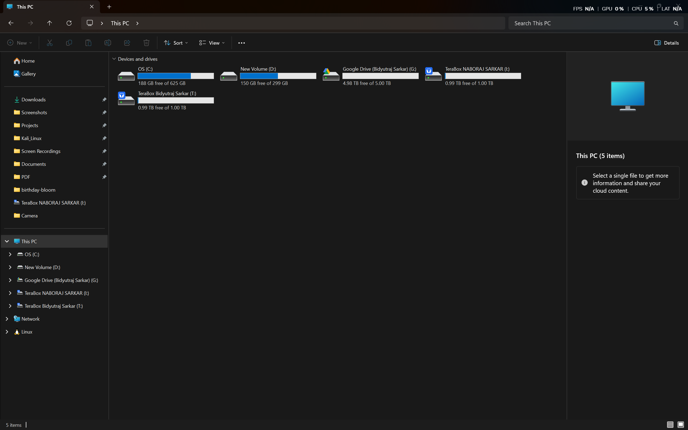
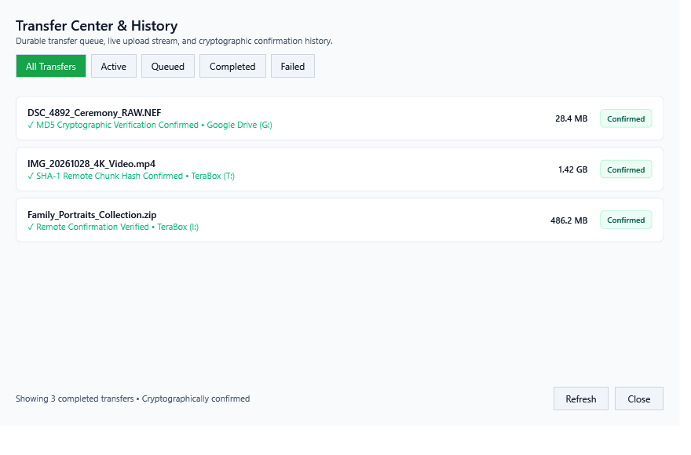
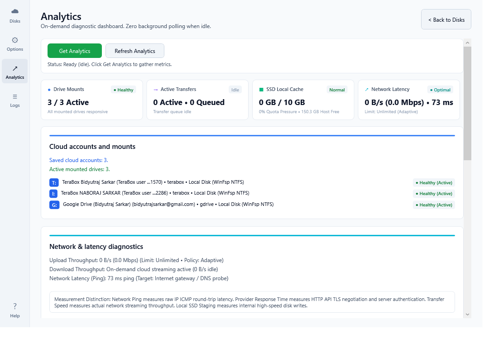
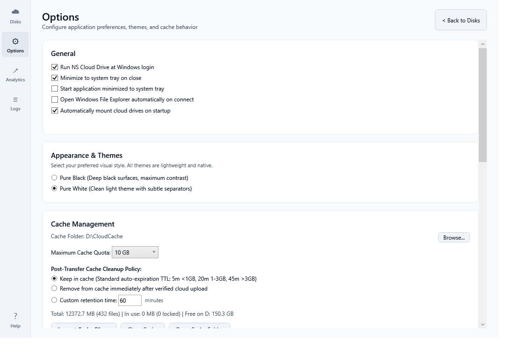
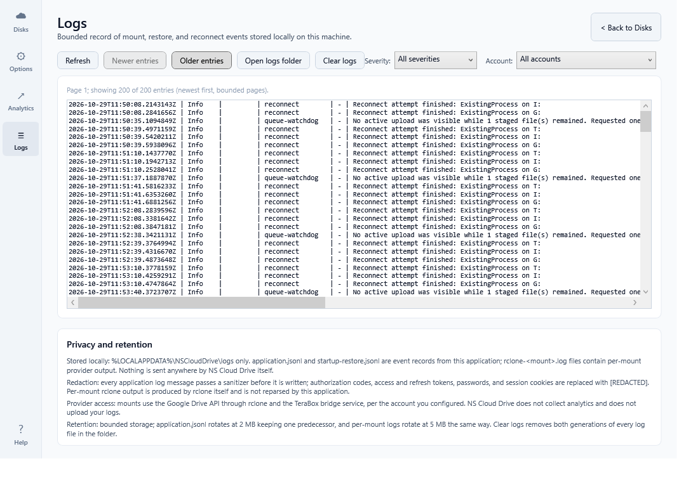

# NS Cloud Drive — Visual User Guide & Interface Walkthrough

Welcome to the **NS Cloud Drive User Guide**. This document provides an in-depth visual tour and operational walkthrough of all core features, screens, and workflows in the application.

---

## 1. Disks Dashboard (Main Screen)

The **Disks Dashboard** is the primary hub of NS Cloud Drive. It provides real-time visibility into all configured cloud accounts, active Windows mount points, and quick management actions.

<p align="center">
  
</p>

### Key Interface Elements:
- **Header Status Banner**: Displays overall mount status across all accounts (e.g., `All 3 drives connected`). Shows interactive badges for each mounted drive letter (`T:`, `I:`, `G:`).
- **Toolbar Actions**:
  - `+ Add Cloud Disk`: Launches the provider connection dialog to connect Google Drive, TeraBox, Linux VPS (SSH/SFTP), or Proton Drive.
  - `⇄ Transfer Files`: Opens the Cloud-to-Cloud & Cloud-to-VPS Transfer dialog to transfer files directly between connected accounts.
  - `⇄ Transfers`: Opens the durable transfer queue and cryptographic history modal.
  - `Refresh`: Manually triggers a health and mount status probe across all virtual disks.
- **Drive Cards**:
  - **Account Details**: Shows provider type (Google Drive, TeraBox, VPS Remote, or Proton Drive), user display name, and registered email or account ID.
  - **Mount Status Pill**: Green dot indicator (`● Mounted (G:)`) confirms active WinFsp filesystem integration.
  - **Mount / Disconnect Button**: Toggle button to mount or safely disconnect virtual drives on demand.
  - **Drive Letter Selector**: Select and assign preferred available Windows drive letters.
  - **Open Explorer Button**: Immediately opens Windows File Explorer at the virtual disk root.
  - **Account Settings & Reordering**: Configure account-specific options or drag cards to reorder.

---

## 2. Native Windows File Explorer Integration

Once mounted, all cloud disks appear directly inside Windows 11 File Explorer under **Devices and drives** just like physical storage volumes.

<p align="center">
  
</p>

### Native Windows Features:
- **Direct Volume Letter Assignment**: Each account receives its own designated drive letter (e.g., `G:`, `I:`, `T:`).
- **Active Capacity Gauges**: Real-time storage consumption and remaining gigabytes/terabytes display natively in Windows Explorer.
- **Provider Branding**: Official high-resolution cloud icons (Google Drive, TeraBox) display in File Explorer for instant visual recognition.
- **Direct Shell Integration**: Drag-and-drop file copying, standard right-click context menus, and on-demand streaming on file open.

---

## 3. Cloud Transfer Center & History

The **Transfer Center** tracks all file transfers, local SSD staging progress, background uploads, and cryptographic confirmation results.

<p align="center">
  
</p>

### Core Features:
- **Durable Queue Lifecycle**: Tracks files through staging, streaming, remote confirmation, and eviction.
- **Cryptographic Verification**: Confirms uploads against provider hashes (e.g., MD5 for Google Drive, SHA-1 chunk verification for TeraBox) before marking transfers as complete.
- **Category Filters**: Easily filter records by `All Transfers`, `Active`, `Queued`, `Completed`, and `Failed`.
- **Safe Recovery**: If a transfer is interrupted by a system restart, clear status indicators guide you to safely resume or re-upload files without risk of data corruption.

---

## 4. On-Demand Analytics & Performance Monitor

The **Analytics Dashboard** provides comprehensive hardware resource, network latency, and filesystem health metrics gathered strictly on demand—guaranteeing **zero background CPU polling** when idle.

<p align="center">
  
</p>

### Telemetry Breakdown:
- **Drive Mounts**: Probes each active WinFsp NTFS mount root for real-time filesystem responsiveness (`Healthy (Active)` vs `Degraded`).
- **Active Transfers**: Real-time count of streaming and queued operations.
- **SSD Local Cache Quota**: Measures current cache utilization against configured maximum limits (e.g., `0 GB / 10 GB`) and available host drive storage.
- **Network Latency & Bandwidth Probes**: Measures live ICMP round-trip ping to public gateways and reports active streaming throughput.
- **Resource Footprint**: Displays current process RAM usage, working set size, and background worker state.

---

## 5. Options & Appearance Settings

The **Options** screen allows customization of visual themes, SSD staging folder locations, cache eviction rules, and Windows operating system integration.

<p align="center">
  
</p>

### Configuration Options:
- **General Integration**:
  - `Run NS Cloud Drive at Windows login`: Registers automatic startup via Windows Run registry key.
  - `Minimize to system tray on close`: Keeps cloud drives mounted in the background when the main window is closed.
  - `Automatically mount cloud drives on startup`: Restores all configured virtual drives upon login.
- **Appearance & Themes**:
  - **Pure White**: High-contrast, clean modern light theme with refined borders and typography.
  - **Pure Black**: Deep OLED dark theme with vibrant color-coded status badges.
- **Cache Management**:
  - **Cache Folder**: Configurable dedicated high-speed SSD location (default: `D:\CloudCache`).
  - **Maximum Cache Quota**: Set cache limits from 5 GB up to 100 GB.
  - **Post-Transfer Cleanup Policy**: Automatically evict completed files using size-dependent inactivity TTLs (5m for <1GB, 20m for 1-3GB, 45m for >3GB) with strict `Test-FileInUse` lock protection.

---

## 6. Security & Audit Diagnostic Logs

The **Logs** view offers full transparency into application events, provider session validations, and mount operations while guaranteeing absolute privacy.

<p align="center">
  
</p>

### Security & Privacy Protections:
- **Real-Time Sanitization**: All OAuth access tokens, refresh tokens, passwords, and session cookies are automatically replaced with `[REDACTED]` before logs are written to disk.
- **Severity & Account Filtering**: Filter events by `Info`, `Warning`, or `Error`, or isolate logs for a specific cloud account.
- **Local Bounded Storage**: Logs are stored strictly on your local machine in `%LOCALAPPDATA%\NSCloudDrive\logs` and automatically rotate at 2 MB to prevent unbounded disk usage.
- **Zero Remote Telemetry**: NS Cloud Drive never transmits log files, personal filenames, or diagnostic traces to external third-party servers.

---

## 7. Cloud Storage & VPS Provider Setup Guides

### 7.1 Linux VPS / Remote Agent Server (SSH & SFTP)
Connect remote Linux VPS instances (e.g. cloud servers running AI agents, remote databases, or computational jobs) to mount them directly as Windows drive letters:
1. Click **+ Add Cloud Disk** and select **VPS / Remote Server (SSH & SFTP)**.
2. Enter your VPS **Server Host / IP** (e.g., `130.210.42.209` or domain) and **SSH Port** (default `22`).
3. Enter your **SSH Username** (e.g., `root` or user account).
4. Choose authentication: **Password** or **SSH Private Key** (browse `.pem`, `id_rsa`, or OpenSSH keys).
5. Specify the **Remote Root Path** (e.g., `/` for root, `/home/user`, or `/workspace`).
6. Click **Test SSH Connection** to verify reachability and disk capacity.
7. Click **Connect & Mount** to assign a drive letter (default `V:`) and mount the remote server natively in Windows File Explorer!

### 7.2 Proton Drive (Zero-Knowledge SRP)
Mount end-to-end encrypted cloud storage without installing heavy desktop clients:
1. Click **+ Add Cloud Disk** and select **Proton Drive**.
2. Enter your Proton account **Username / Email** and **Password**.
3. (Optional) Provide your **Two-Factor Authentication Code (2FA)** if 2FA is active.
4. (Optional) Provide your **Mailbox Password** if your account uses Proton's legacy two-password mode.
5. Click **Connect & Mount** to assign a drive letter (default `P:`) and mount Proton Drive into Windows File Explorer.

### 7.3 MEGA (20 GB Free End-to-End Encrypted)
Mount encrypted MEGA storage as a native Windows drive:
1. Click **+ Add Cloud Disk** and select **MEGA**.
2. Enter your MEGA account **Email Address** and **Password**.
3. Credentials are securely encrypted on disk using Windows DPAPI.
4. Assign an available drive letter (default `M:`) and click **Connect & Mount**.

### 7.4 S3 / Metal Object Storage (AWS, Cloudflare R2, MinIO, Wasabi, Metal)
Mount high-performance object storage buckets as local drives:
1. Click **+ Add Cloud Disk** and select **S3 / Metal Object Storage**.
2. Choose your provider template (AWS, Cloudflare R2, MinIO, Wasabi, or Custom S3 / Metal).
3. Specify the **Endpoint URL** (e.g. `https://<accountid>.r2.cloudflarestorage.com`, leave blank for AWS S3).
4. Enter your **Region** (e.g. `us-east-1`, `auto`).
5. Enter your **Access Key ID** and **Secret Access Key**.
6. (Optional) Enter the specific **Bucket Name** to mount.
7. Assign an available drive letter (default `S:`) and click **Connect & Mount**.

---

## 8. Intelligent Pre-Transfer Deduplication & Delta Classifier

When moving hundreds or thousands of files to the cloud, NS Cloud Drive ensures you never waste time or bandwidth re-uploading files that already exist on your drive:

### 8.1 How Pre-Transfer Deduplication Works
1. **Remote Cloud Inspection**: Before scheduling an upload, NS Cloud Drive rapidly inspects the destination directory in cloud storage (via local mount cache or direct API query).
2. **Format Verification**: Checks whether the file extension/format matches (e.g. `.png` vs `.png`, `.jpg` vs `.jpg`). If the local file has been converted (for example, from PNG to JPG), it is flagged as a format mismatch and queued for transfer.
3. **Exact Size Match**: Verifies exact byte sizes between local and cloud files. If sizes differ, the file is recognized as modified and queued for re-upload.
4. **Instant Skip**: If the remote file exists with the exact same format and byte count, it is classified as `AlreadyInCloud` and marked complete in milliseconds without touching your network connection!
5. **Durable Ledger Across Restarts**: Verified files are recorded in `%LOCALAPPDATA%\NSCloudDrive\cache\cloud-dedup-ledger.json`. When restarting your PC or re-adding folders, the system remembers previous confirmations instantly—eliminating hours of redundant re-uploads.

### 8.2 Command-Line Deduplication Inspection
You can test and inspect file deduplication before uploading using the CLI tool:
```powershell
.\scripts\Invoke-CloudDeduplication.ps1 -SourcePath "D:\Photos" -ProviderId gdrive -DestinationPath "Backups/Photos" -Detailed
```

---

## 9. Autonomous AI Agent Integration & Sync Pairs

NS Cloud Drive provides a dedicated toolset for developers running autonomous AI agents on remote servers or local machines:

### 9.1 High-Speed Bidirectional Agent Transfers
Transfer large files or complete agent workspaces with optional stream compression:
```powershell
.\scripts\Invoke-AgentTransfer.ps1 -Direction Push -LocalPath "C:\Data\Models" -RemotePath "/home/agent/workspace" -Compress
```

### 9.2 Remote Agent Reverse Webhooks & Toast Alerts
Autonomous AI agents running on a VPS can notify the Windows desktop upon task completion by posting a lightweight JSON payload to the local webhook listener:
```bash
curl -X POST http://<windows-host-ip>:5998/agent-notify \
  -H "Content-Type: application/json" \
  -d '{"eventType":"task_completed","agentName":"Orchestra Coder","message":"Build succeeded and test suite passed.","status":"success"}'
```
This triggers a native Windows desktop toast alert and records the notification in `%LOCALAPPDATA%\NSCloudDrive\logs\agent-notifications.jsonl`.

### 9.3 Automated Sync Pairs & File Watchers
Establish automated continuous synchronization between local folders and remote agent directories:
```powershell
# Add a new sync pair with automatic filesystem watcher
.\scripts\Invoke-SyncPair.ps1 -Action Add -Name "Agent Workspace" -LocalPath "C:\Agent\Workspace" -RemotePath "/home/agent/workspace" -ProviderId vps -Watch

# Run a sync pair on demand
.\scripts\Invoke-SyncPair.ps1 -Action Run -SyncPairId sync_12345
```

---

## 10. Community Discussion & Support

Have questions about setup, configuration, or want to suggest new features for future releases?
- **Community Discussion Hub**: [https://github.com/naborajs/CloudDrive/discussions/1](https://github.com/naborajs/CloudDrive/discussions/1)
- **Issue Tracker**: [https://github.com/naborajs/CloudDrive/issues](https://github.com/naborajs/CloudDrive/issues)
- **Official Repository**: [https://github.com/naborajs/CloudDrive](https://github.com/naborajs/CloudDrive)
